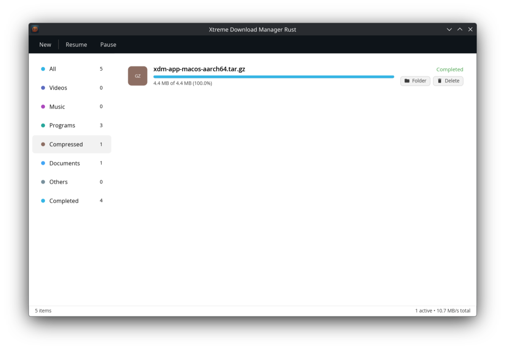
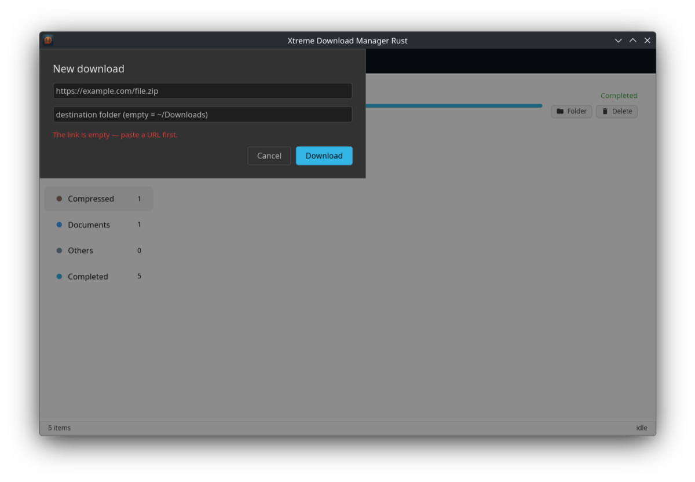

<p align="center">
  
</p>

<h1 align="center">XDM Rust</h1>

<p align="center">
  <b>A Rust rewrite of Xtreme Download Manager — fast, resumable downloads and one-click video grabbing, right from your browser.</b>
</p>

<p align="center">
  <a href="https://github.com/amajust/xdm/actions/workflows/rust.yml"></a>
  <a href="https://github.com/amajust/xdm/releases"></a>
  
  
</p>

<p align="center">
  <a href="#-download"></a>
</p>

---

<p align="center">
  
</p>

<p align="center">
  
</p>

## About

**XDM Rust** is a ground-up Rust rewrite of
[Xtreme Download Manager](https://github.com/subhra74/xdm) — the classic,
feature-rich download manager for Windows, macOS and Linux originally created
by Subhra Das ([xtremedownloadmanager.com](https://xtremedownloadmanager.com/)).

All credit for the original application, its design and its years of
development goes to the upstream project. This repository is a fork that
replaces the Java codebase with a modern Rust implementation while keeping
the spirit of the original: fast parallel downloads, browser integration and
video grabbing.

> **Status: alpha.** The rewrite is under active development on the
> [`rust-rewrite`](https://github.com/amajust/xdm/tree/rust-rewrite) branch.
> The original Java application remains available on the `master` branch.

## Features

- **Resumable multi-connection engine** — downloads are split across
  connections and survive restarts, with per-chunk state persisted to disk
- **Browser integration** — the companion browser extension hands downloads
  and detected videos straight to the app (see
  [`browser-extension/`](browser-extension/))
- **Cross-platform GUI** (iced): category sidebar, download rows with live
  progress and speed, system tray (Linux), native per-OS taskbar icons
- **Per-row actions** — open the download's folder in the native file
  manager, delete a download together with its files (engine-safe)
- **Link validation** — the New-download dialog explains what's wrong
  instead of failing silently

## Download

Grab the latest build from the
[releases page](https://github.com/amajust/xdm/releases) — every release
ships `.tar.gz` packages for:

| Platform | Package |
| --- | --- |
| Linux x86_64 | `xdm-app-linux-x86_64.tar.gz` |
| macOS (Apple Silicon) | `xdm-app-macos-aarch64.tar.gz` |
| Windows x86_64 | `xdm-app-windows-x86_64.tar.gz` |

Extract and run the `xdm-app` binary (`tar xf <package>` — Windows 10+
handles this natively).

## Building from source

Requirements: a stable Rust toolchain ([rustup](https://rustup.rs)).

```bash
git clone https://github.com/amajust/xdm.git
cd xdm
git checkout rust-rewrite

# Linux only: Wayland/x11 build dependencies
sudo pacman -S libwayland libxkbcommon   # Arch/CachyOS
# or: sudo apt install libwayland-dev libxkbcommon-dev  # Debian/Ubuntu

cargo build --release -p xdm-app
./target/release/xdm-app
```

CI builds and tests the workspace on Linux, macOS and Windows on every
change; pushing an `xdm-app-v*` tag publishes a release with all three
packages automatically.

## License

This project is licensed under the
[GNU GPL v3](LICENSE), inherited from the original
Xtreme Download Manager by Subhra Das.
